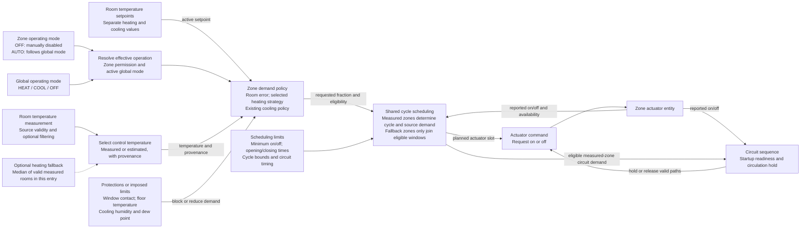
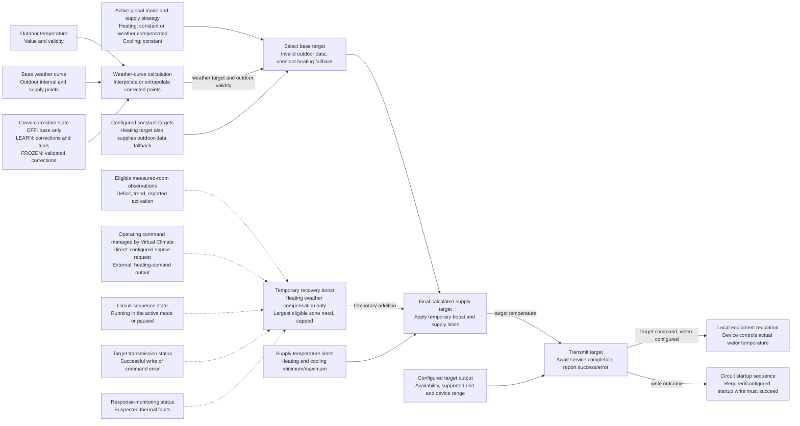
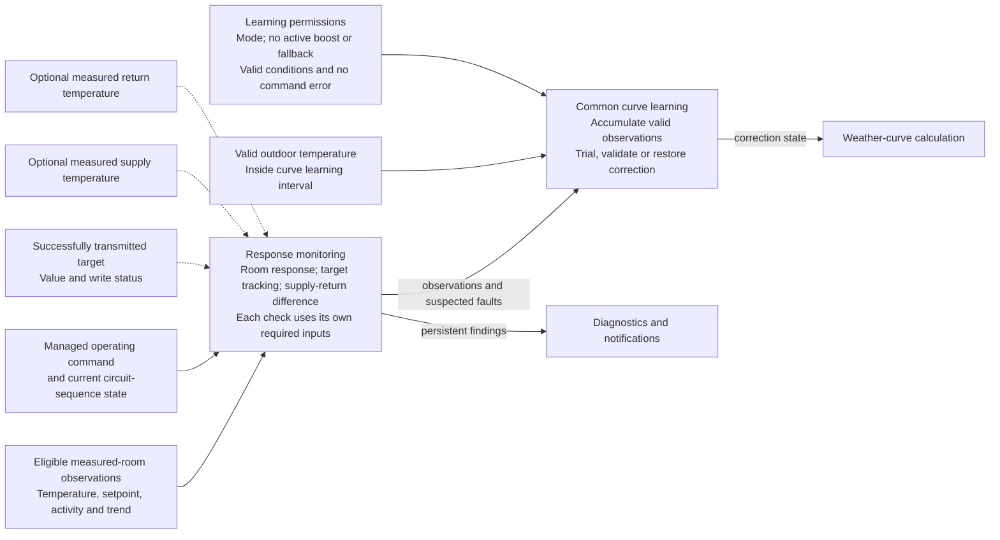

# Control flows

These diagrams describe information dependencies and operational responsibilities.
They are not hydraulic schematics or a literal sequence of function calls.
Each node represents one responsibility; each labelled wire identifies information
that its consumer needs. Dashed wires carry conditional inputs. Feedback wires
carry reported software state, not proof of water flow or delivered heat.

## Zone measurements, demand, and actuator

### Zone node contracts

| Node | Required information | Output and missing-data behavior |
| --- | --- | --- |
| Effective operation | Zone OFF/AUTO, global mode, zone heating/cooling compatibility | Permission for the active mode. AUTO follows the global mode; global OFF stops new cycles without changing AUTO to manual OFF. |
| Control temperature | Valid primary room measurement; fallback setting and donors if needed | Temperature plus measured/estimated provenance. Fallback is opt-in and heating-only; without either reference, the zone cannot calculate normal temperature demand. The displayed measurement remains unavailable during fallback. |
| Protections or imposed limits | Configured contacts, floor measurement and bounds, cooling humidity/dew-point inputs | Blocking reasons or cooling derating. A missing floor measurement contributes no floor limit. Diagnostic floor bounds must not be drawn as additional interlocks. |
| Zone demand policy | Active room setpoint, effective operation, control temperature, protections, selected strategy | Requested heating/cooling fraction and eligibility. Adaptive heating additionally uses actuator history and its thermal model; it does not write supply targets. |
| Shared scheduling | Zone requests and provenance, timing constraints, reported actuator transitions | Planned slots and eligible circuit demand. Fallback zones cannot create source demand, determine cycle length, or extend the source request. A restart lockout can delay scheduling while thermal demand remains visible. |
| Actuator command and feedback | Planned slot, protection decisions, circuit circulation requirements | On/off requests and separately reported activation. A valid valve can remain open beyond its own slot for circulation. Safety-blocked zones cannot be retained as valid paths. |

See [Operation](../operation.md), [temperature fallback](../features/temperature-fallback.md),
and [adaptive heating](../features/adaptive-control.md) for the policies represented
by these nodes, including evaluation timing and adaptive validation limits.

## Supply target calculation and transmission

### What the operating-command node means

Virtual Climate owns a command requesting source or circuit operation: a configured
source request in the direct profile, or the heating-demand output in the external
profile. This ownership is the **controlled operating-request context** used by
the supply policy. An omitted direct source output does not create an implicit
command. A pump output alone does not establish source-request ownership.

Ownership and current activity are separate inputs. The coordinator also reports
whether its circuit sequence is in the running state for the active mode. Neither
ownership nor this software state establishes combustion, water flow, or delivered
heat. See [reported-state boundaries](../operation.md#protection-and-reported-state).

Weather-curve calculation needs neither an owned source command nor measured
supply/return temperatures. Recovery boost, common curve learning, and active
room-response monitoring need the controlled request context and their own
eligible observations. The separate observational zone model can learn with an
independently managed source.

### Supply node contracts

| Node | Required information | Output and missing-data behavior |
| --- | --- | --- |
| Weather-curve calculation | Valid outdoor temperature, base points and outdoor interval; correction state according to learning mode | Supply target from interpolation/extrapolation. Invalid outdoor data selects the configured constant heating fallback. Learning pauses outside the curve interval, but calculation continues by extrapolation within supply limits. |
| Recovery boost | Enabled heating weather compensation, managed operating command, circuit-sequence state, target transmission status, response-monitoring status, eligible measured-room deficits/trends and reported activation | Separate temporary supply increment. Increasing boost requires running context, successful target transmission, no suspected fault, and sufficient recent activation. Disabled during outdoor-data fallback. Fallback-room estimates do not contribute; eligible measured rooms still can. Normal slot pauses do not erase boost while deficit remains. |
| Final target | Selected constant/weather target, permitted boost, active-mode supply limits | Bounded calculated temperature. Curve correction, trial adjustment, and boost remain separately observable. A calculated target does not establish transmission. |
| Target transmission | Configured writable output, calculated target, compatible unit and device range | Successful transmission or command error. A required startup failure prevents a new start; an operational failure causes retries/notification without itself stopping the source. External control may omit this output and use the controller's own target. |
| Local regulation | Target accepted by the equipment, its own sensors and regulation logic | Equipment-dependent regulation and protections. Firmware, mixing-valve control, and hardware interlocks are outside Virtual Climate. |

Configuration temperatures are in degrees Celsius. Sensor units and target-output
conversion are described in [Supply control](../features/supply-control.md#measurements-and-faults).

## Supply observation and learning dependencies

### Observation node contracts

| Function | Required inputs and conditions | Result or unavailable behavior |
| --- | --- | --- |
| Room-response monitoring | Eligible measured-room observations/activity and controlled operating-request context | Detects persistent insufficient response. Fallback rooms are excluded. |
| Supply target verification | Successfully transmitted target, valid supply measurement and operating context | Evaluates target deviation; a calculated but untransmitted target is insufficient. |
| Supply-return difference | Both measured temperatures; operating context for fault interpretation | Temperature difference and contextual monitoring. Missing either measurement disables this check, not curve calculation. |
| Common curve learning | Eligible observations, controlled operating-request context, outdoor conditions inside the interval, permitted learning mode and valid trial conditions | Corrections and experience. Boost, changed conditions, invalid data and command errors interrupt trials. Active fallback or suspected thermal faults suspend learning; validated corrections are retained. |
| Diagnostics | Command results and contextual monitoring findings | Distinguishes command errors from suspected thermal-response faults. Thermal findings alone do not stop the source. |

These are dependency diagrams, not complete state machines. Learning eligibility,
recovery periods, reversible trials, and persistence follow the
[supply guide](../features/supply-control.md) and
[ADRs 0001](../adr/0001-supply-target-and-local-regulation.md),
[0002](../adr/0002-supply-strategies-and-capability-requirements.md), and
[0003](../adr/0003-transparent-learning-and-temporary-correction.md).
